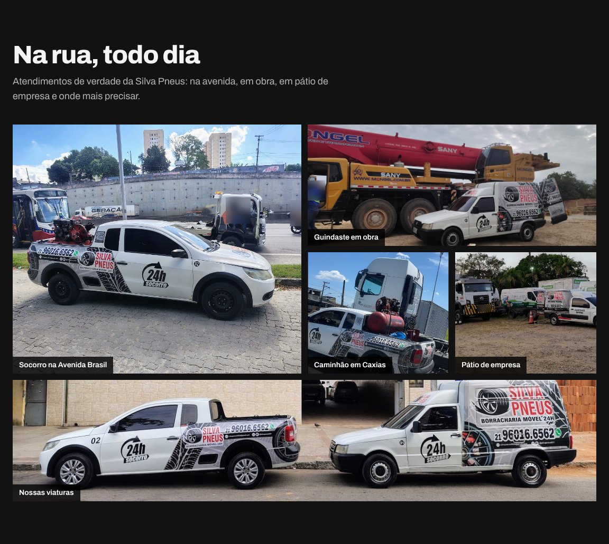

# Silva Pneus - Site da borracharia móvel

Site do cliente **Borracharia Silva Pneus**, borracharia móvel do Rio de Janeiro com **3 bases** (Parada de Lucas, Padre Miguel e Barra da Tijuca) que atende **60 bairros** da Zona Norte, Zona Oeste, Barra e Jacarepaguá e da Baixada Fluminense (Duque de Caxias, São João de Meriti, Nilópolis e Mesquita).

**Site no ar:** [borrachariasilva.vercel.app](https://borrachariasilva.vercel.app)


## O problema

A Silva Pneus já tinha nota 5,0 no Google e um bom volume de clientes, mas a presença online não acompanhava o tamanho da operação:

- **Não tinha site próprio.** O link das fichas do Google levava para uma página alugada em um portal de anúncios, genérica, com a marca do portal no rodapé e que sai do ar se a mensalidade parar.
- **Dependia de anúncio pago para ser encontrada.** O dono usava Google Ads e queria parar de pagar por clique para aparecer.
- **As 3 bases não tinham o mesmo peso no Google.** Parada de Lucas tinha mais de 260 avaliações, enquanto Padre Miguel tinha 1 e a Barra da Tijuca tinha 6. Os horários estavam diferentes de ficha para ficha.
- **Quem procura borracharia móvel está parado na rua.** A pessoa precisa achar o telefone e chamar em segundos, pelo celular, sem formulário.
- **Nada mostrava o trabalho de verdade.** As avaliações e as fotos de atendimento ficavam espalhadas em 3 fichas e no Instagram.
- **O dono não é da área de tecnologia.** A solução precisava ser fácil de manter, sem custo fixo de servidor e com tudo no nome da empresa.

## O que foi entregue

| Problema | Solução |
| --- | --- |
| Página alugada no portal de anúncios | Site próprio, com domínio e hospedagem no nome da empresa |
| Dependência de anúncio pago | SEO local: dados estruturados (`AutoRepair`), horário, área atendida, Open Graph e os 60 bairros listados por base |
| Bases com presença desigual | Uma seção por base com mapa, endereço e bairros atendidos, e o mesmo site para as 3 fichas do Google |
| Cliente parado na rua, no celular | Telefone gigante no topo com toque para ligar, botão de WhatsApp e barra fixa no rodapé do celular |
| Reputação espalhada | Nota, total e avaliações das 3 fichas puxados do Google e atualizados todo dia, mais galeria com fotos reais dos atendimentos |
| Dono sem conhecimento técnico | Site estático, sem servidor e sem banco. Todo o conteúdo fica em um único arquivo (`src/lib/dados.ts`) |

Além disso:

- **Identidade visual tirada da plotagem dos carros:** a faixa de banda de rodagem, o selo de socorro com seta circular e os ícones dos serviços seguem o mesmo traço da arte das viaturas. O logo e o ícone da aba mudam com o tema.
- **Modo escuro como padrão e modo claro opcional**, com a escolha salva no navegador.
- **Animações de rolagem leves,** que se desligam para quem pede menos movimento no sistema.
- **Cuidado com privacidade nas fotos:** usei só as fotos publicadas pelo próprio dono, com rostos de terceiros e placas de clientes desfocados.

<p>
  
  &nbsp;
  
</p>

## Decisões técnicas

- **Next.js com exportação estática (`output: "export"`).** O build gera só HTML, CSS e JS, então o site roda de graça em hospedagem estática (Cloudflare Pages ou Vercel), carrega rápido em 4G e não tem servidor para manter.
- **Avaliações do Google no build, não no navegador.** A chave da API do Google Places fica só no servidor de build e nunca chega ao visitante. Um workflow do GitHub Actions dispara um novo build por dia para atualizar a nota e as avaliações.
- **Sem a chave, nada quebra.** Se a variável não existir ou o Google falhar, o site usa as avaliações salvas no código.
- **Conteúdo separado do layout.** Telefone, horário, serviços, bases, bairros, fotos e perguntas ficam em `src/lib/dados.ts`, o que deixa as alterações rápidas e baratas para o cliente.
- **Fonte auto-hospedada** (`@fontsource-variable/archivo`), sem chamada ao Google Fonts.
- **Tema sem piscar:** um script curto no `<head>` aplica o tema salvo antes da página aparecer.

## Tecnologias

- Next.js 16 (App Router) e React 19
- TypeScript
- Tailwind CSS 4
- Google Places API (New)
- GitHub Actions
- Vercel (demonstração) e Cloudflare Pages (hospedagem final, no nome do cliente)

## Estrutura

```
src/
  app/            layout (metadados, SEO, tema) e página
  components/     seções do site (Hero, Galeria, Servicos, Bases, Avaliacoes, Instagram, Duvidas, Rodape...)
  lib/dados.ts    todo o conteúdo: telefone, horário, serviços, bases, bairros, fotos, avaliações e perguntas
  lib/google.ts   busca nota e avaliações no Google Places API (New) durante o build
public/img/       logo, favicon, imagem de compartilhamento e fotos dos atendimentos
.github/workflows atualização diária das avaliações
```

## Rodando localmente

```bash
npm install
npm run dev        # desenvolvimento em http://localhost:3000
npm run build      # gera o site estático na pasta out/
npm run typecheck  # checagem de tipos
```

## Avaliações do Google

No build, `src/lib/google.ts` acha cada ficha pelo nome e pela coordenada da base, busca nota, total e avaliações e mostra as 3 mais recentes, com o nome do autor e o link para o Google.

1. No Google Cloud, ative a **Places API (New)** e crie uma chave restrita a essa API.
2. Na hospedagem, crie a variável de ambiente `GOOGLE_PLACES_API_KEY` com a chave.
3. Crie um deploy hook na hospedagem e salve a URL no segredo `DEPLOY_HOOK_URL` do repositório.

## Deploy

- **Cloudflare Pages:** build command `npm run build`, output directory `out`.
- **Vercel:** preset Next.js, sem configuração extra.

## Autor

Desenvolvido por **Matheus Ansel**

- Portfólio: [matheusansel-dev.vercel.app](https://matheusansel-dev.vercel.app)
- LinkedIn: [linkedin.com/in/matheusansel](https://www.linkedin.com/in/matheusansel)
- GitHub: [github.com/MatheusAnsel](https://github.com/MatheusAnsel)
